<div align="center">

<!-- Custom Animated SVG Cyberpunk Terminal Banner (Hosted Locally — Never Breaks) -->


<br/><br/>

<!-- Interactive Badge Bar -->
<p align="center">
  <a href="https://www.linkedin.com/in/karan-khot-22bab227a" target="_blank">
    
  </a>
  &nbsp;
  <a href="mailto:karankhot1882@gmail.com">
    
  </a>
  &nbsp;
  <a href="https://wa.me/919112801882" target="_blank">
    
  </a>
  &nbsp;
  
  &nbsp;
  
</p>

</div>

---

### ⚡ System Identity & Executive Specs

```yaml
┌─────────────────────────────────────────────────────────────────────────────┐
│ DEVELOPER SPECIFICATION                                                     │
├───────────────────────┬─────────────────────────────────────────────────────┤
│ Identity              │ Karan Ajit Khot (KK)                                │
│ Academic Credential   │ B.Tech in Computer Science & Engineering (2027)     │
│ Alma Mater            │ Ashokrao Mane Group of Institutions (AMGOI), MH     │
│ Cumulative CGPA       │ 7.0 / 10.0                                          │
│ Engineering Focus     │ Full-Stack Architecture, REST APIs, AI/LLM Systems  │
│ Current Mission       │ Open for Software Engineering Roles & SDE Interns   │
│ Operational Base      │ Kolhapur / Ashta, Maharashtra, India                │
└───────────────────────┴─────────────────────────────────────────────────────┘
```

> **Developer Creed:** *"Transforming ideas into high-performance applications, structured full-stack architectures, and intuitive digital experiences — engineered with precision and clean code."*

---

### 📊 Technical Power Matrix

```ini
[Full-Stack Architecture]   ████████████████████ 96%  (React, Node.js, Express, RESTful APIs)
[AI & LLM Engineering]       ██████████████████▒▒ 91%  (Vector Search, RAG Workflows, Prompt Engineering)
[Databases & Schema Design]  ██████████████████▒▒ 90%  (PostgreSQL, MySQL, MongoDB, Relational Models)
[Problem Solving & Logic]    ███████████████████▒ 93%  (Data Structures, System Workflows, Debugging)
[DevOps & Tooling]           ██████████████████▒▒ 89%  (Git, Linux, Vercel, Postman, CI/CD)
```

---

### 🛠️ Technical Stack & Tooling

<div align="center">

#### Core Languages
<a href="https://skillicons.dev">
  
</a>

#### Frontend Frameworks & UI
<a href="https://skillicons.dev">
  
</a>

#### Backend & Databases
<a href="https://skillicons.dev">
  
</a>

#### AI & Modern Dev Tools
<p align="center">
  
  &nbsp;
  
  &nbsp;
  
</p>
<a href="https://skillicons.dev">
  
</a>

</div>

---

### 🚀 Highlighted Engineering Projects

<table>
  <tr>
    <td width="50%" valign="top">
      <h3>🚗 RideX — Cab Booking Platform</h3>
      <p>A full-stack role-based ride booking platform engineered with <strong>Node.js, Express.js, and MySQL</strong>.</p>
      <ul>
        <li>Interactive passenger booking flow with live fare calculation and route points</li>
        <li>Driver dispatch queue management with verified session authentication</li>
        <li>Clean normalized SQL schema with transaction consistency</li>
      </ul>
      <p>
        <a href="https://github.com/karanajitkhot/RideX"><b>Explore Repository ➔</b></a>
      </p>
    </td>
    <td width="50%" valign="top">
      <h3>🎬 Cineverse — Cinematic Discovery</h3>
      <p>A high-performance streaming-style movie discovery catalog integrated with the official <strong>TMDB REST API</strong>.</p>
      <ul>
        <li>Instant client-side debounced search, genre tags, and smooth trailer preview cards</li>
        <li>Responsive glassmorphic UI with dynamic layout scaling</li>
        <li>Deployed to production on Vercel with zero bundle bloat</li>
      </ul>
      <p>
        <a href="https://cineverse-lovat.vercel.app" target="_blank"><b>Live Demo ↗</b></a> &nbsp;|&nbsp;
        <a href="https://github.com/karanajitkhot/cineverse"><b>Explore Repository ➔</b></a>
      </p>
    </td>
  </tr>
  <tr>
    <td width="50%" valign="top">
      <h3>💊 MedPlatform — Prescription &amp; Medicine Hub</h3>
      <p>A modern healthcare platform designed to streamline pharmacy inventory searches and doctor prescription dispatch.</p>
      <ul>
        <li>Component-driven React architecture with strict state separation</li>
        <li>Real-time form validation and error boundary controls</li>
        <li>Optimized production build hosted live on Vercel</li>
      </ul>
      <p>
        <a href="https://medicine-platform-frontend.vercel.app" target="_blank"><b>Live Demo ↗</b></a> &nbsp;|&nbsp;
        <a href="https://github.com/karanajitkhot/medicine-platform-frontend"><b>Explore Repository ➔</b></a>
      </p>
    </td>
    <td width="50%" valign="top">
      <h3>☁️ CloudTech Hub — Cloud Infrastructure Portal</h3>
      <p>An interactive knowledge portal breaking down cloud service models (IaaS, PaaS, SaaS) and virtualization architectures.</p>
      <ul>
        <li>Responsive interactive architectural diagrams</li>
        <li>Continuous deployment on GitHub Pages</li>
        <li>Pure semantic HTML5, CSS3, and modern vanilla JavaScript</li>
      </ul>
      <p>
        <a href="https://karanajitkhot.github.io/cloud-tech-hub/" target="_blank"><b>Live Demo ↗</b></a> &nbsp;|&nbsp;
        <a href="https://github.com/karanajitkhot/cloud-tech-hub"><b>Explore Repository ➔</b></a>
      </p>
    </td>
  </tr>
</table>

---

### 🐍 Contribution Activity Snake

<div align="center">
  
</div>

---

### 🌐 Direct Communication Channels

<div align="center">

Interested in discussing software development opportunities, engineering roles, or collaborative projects? Reach out directly:

<br/>

<a href="https://www.linkedin.com/in/karan-khot-22bab227a" target="_blank">
  
</a>
&nbsp;
<a href="mailto:karankhot1882@gmail.com">
  
</a>
&nbsp;
<a href="https://wa.me/919112801882" target="_blank">
  
</a>

<br/><br/>

<p align="center">
  <i>"Turning ideas into practical applications, full-stack systems, and reliable software one commit at a time."</i>
</p>

</div>

<!-- Verified engineering profile -->
